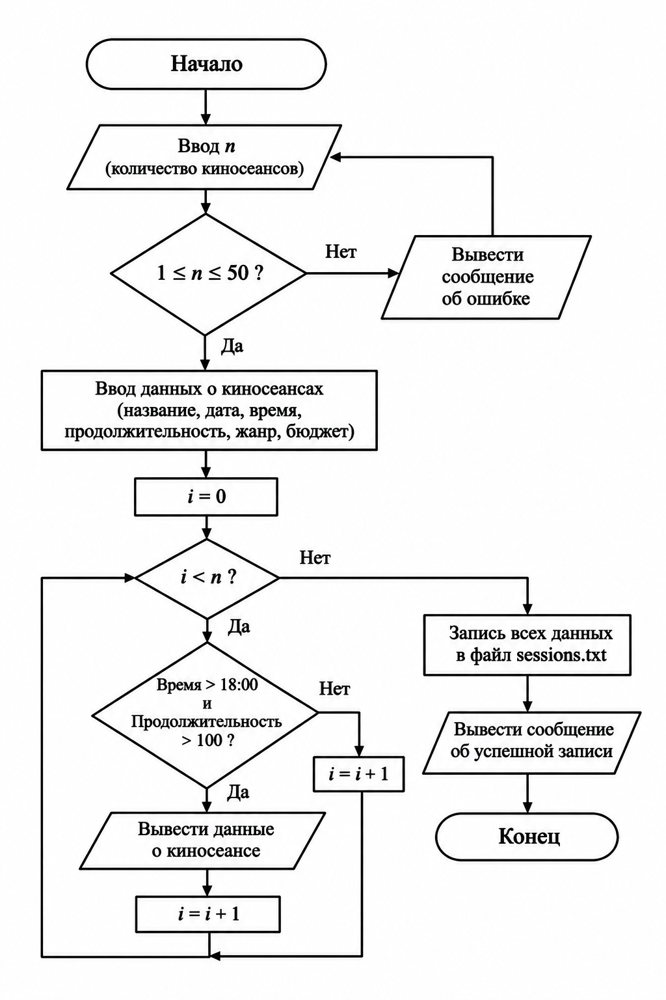

# Лабораторная работа №12
## Работа со структурами и файлами в языке C

**Вариант 12 — «Киносеанс»**

### Условие задачи

Разработать программу на языке C для работы с массивом структур «Киносеанс».

Каждая структура содержит следующие поля:
- Название фильма
- Дата и время сеанса
- Продолжительность сеанса
- Жанр
- Бюджет

Программа должна:

1. Организовать ввод записей о киносеансах.
2. Вывести сведения о фильмах, сеансы которых начинаются после 18:00.
3. Учитывать только сеансы продолжительностью более 1 часа 40 минут.
4. Записать введённые данные в текстовый файл `sessions.txt`.
5. Использовать отдельную функцию для записи данных в файл.

### 1. Алгоритм и блок-схема

Алгоритм работы программы:

1. Ввод количества киносеансов.
2. Проверка корректности количества.
3. Ввод названия фильма, даты, времени, продолжительности, жанра и бюджета.
4. Проверка времени начала сеанса.
5. Проверка продолжительности сеанса.
6. Вывод информации о подходящих фильмах.
7. Открытие файла `sessions.txt`.
8. Запись структур в файл.
9. Закрытие файла.
10. Завершение программы.

**Блок-схема алгоритма:**



### 2. Реализация программы

Программа разрабатывается на языке **C**.

Для хранения информации используется структура `CinemaSession`:

```c
typedef struct
{
    char title[100];
    char date[20];
    int hour;
    int minute;
    int duration;
    char genre[50];
    double budget;
} CinemaSession;
```

Для записи данных в файл используется функция:

```c
int writefile(const char *fname, const CinemaSession sessions[], int size);
```

Условие отбора киносеансов:

```c
if ((sessions[i].hour > 18 ||
    (sessions[i].hour == 18 && sessions[i].minute > 0)) &&
    sessions[i].duration > 100)
{
    // Вывод информации о киносеансе
}
```

Основные средства языка C:

- `struct` — хранение данных о киносеансах.
- `for` — обработка массива структур.
- `if` — проверка условий отбора.
- `scanf()` — ввод информации.
- `printf()` — вывод результатов.
- `fopen()` — открытие файла.
- `fprintf()` — запись данных в файл.
- `fclose()` — закрытие файла.

### 3. Результаты работы программы

После запуска программа запрашивает количество киносеансов и сведения о каждом из них.

Затем проверяется время начала и продолжительность каждого сеанса.

На экран выводятся только фильмы, которые начинаются после 18:00 и продолжаются более 100 минут.

Все введённые данные сохраняются в текстовом файле `sessions.txt`.

Каждая запись содержит название фильма, дату, время начала, продолжительность, жанр и бюджет.

**Пример содержимого файла `sessions.txt`:**

```text
Avatar 15.11.2026 19:30 162 Fantasy 237000000
Titanic 15.11.2026 17:00 194 Drama 200000000
Inception 16.11.2026 20:15 148 SciFi 160000000
Cars 16.11.2026 18:00 117 Animation 120000000
Dunkirk 17.11.2026 21:00 106 War 100000000
```

**Результат отбора:**

```text
Подходящие киносеансы:

Avatar
Дата: 15.11.2026
Время: 19:30
Продолжительность: 162 мин.

Inception
Дата: 16.11.2026
Время: 20:15
Продолжительность: 148 мин.

Dunkirk
Дата: 17.11.2026
Время: 21:00
Продолжительность: 106 мин.
```

В данном примере условиям соответствуют фильмы Avatar, Inception и Dunkirk.

Titanic не подходит по времени начала, а Cars начинается ровно в 18:00, поэтому также исключается.

### Вывод

В ходе лабораторной работы предусмотрена разработка программы для обработки массива структур на языке C.

Программа должна выполнять поиск киносеансов по заданным условиям, выводить подходящие записи и сохранять информацию в текстовый файл с использованием отдельной функции.
